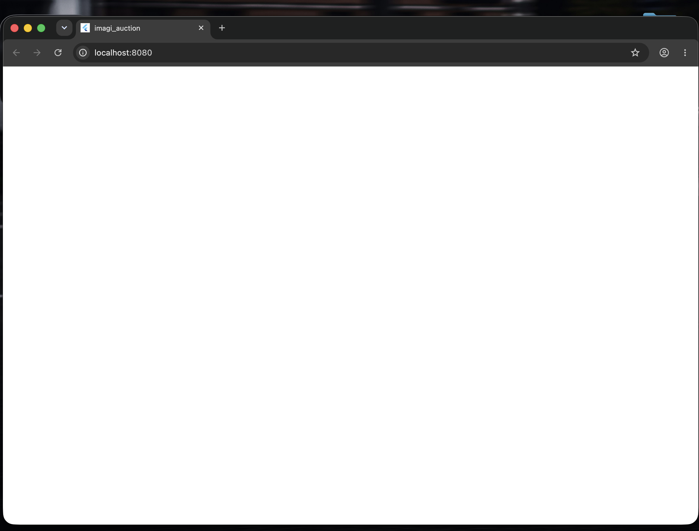

# Imagi Auction

Aplikasi marketplace lelang online berbasis **Flutter + Firebase**, seperti eBay.
Tugas Pemrograman Mobile — Kelompok 5, Kelas C.



## Fitur

| Fitur | Implementasi |
|---|---|
| Autentikasi | Email & password, login Google, verifikasi email, reset password — `lib/ui/auth/` |
| Otorisasi | Role `user` / `admin`: guard di `lib/router.dart` + `firestore.rules` + kebijakan bucket Supabase |
| Navigasi | 4 tab (Home, Trending, Your bids, Account) dengan `StatefulShellRoute` — tiap tab menyimpan posisi scroll |
| Home | Pencarian (debounce), filter kategori, "Ending soon", grid lelang dengan pagination dan pull-to-refresh |
| Trending | Most bids / Most watched / New today (live), kenaikan tawaran 1 jam terakhir, kategori populer |
| Lelang | Proxy bidding otomatis, reserve price, Buy It Now, format Auction / Buy It Now / Both — `lib/domain/bidding/` |
| Detail lelang | Galeri + zoom, share, watchlist, banner status pribadi, riwayat tawaran tersamar, bottom sheet "Place max bid" |
| Jual barang | Upload foto ke Supabase Storage (kompres, urutkan, sampul), validasi, draft, impor katalog DummyJSON |
| Your bids | Bidding / Won / Didn't win / Watchlist, ringkasan Winning / Outbid / To pay |
| Notifikasi | Push FCM + daftar notifikasi (dikelompokkan per hari, swipe hapus + undo, infinite scroll), deep link ke layar yang tepat |
| Checkout | Alamat, kurir, metode bayar, pembayaran **Xendit Invoice** (mode test) dengan webhook |
| Pesanan | Pelacakan Paid → Shipped → In transit → Delivered, konfirmasi terima, laporan masalah (buyer protection), rating |
| Akun | Profil + foto, statistik, listing saya, pesanan, rekening pencairan, alamat, pengaturan notifikasi, hapus akun |
| Bahasa | Inggris & Indonesia (ikut bahasa perangkat) — `lib/l10n/` |
| REST API | [DummyJSON](https://dummyjson.com) untuk katalog, [Frankfurter](https://frankfurter.dev) untuk kurs |
| State management | Riverpod 3 — `lib/providers/providers.dart` |
| Backend | Job terjadwal `cron/run.js` lewat GitHub Actions (tutup lelang, order, push, rating) — tanpa paket Blaze. Pembayaran Xendit tetap di `functions/` (butuh Blaze) |

## Struktur folder

```
lib/
  core/          config (biaya, URL), extension, Result
  data/          repository Firestore, upload foto Supabase, API client, service (notifikasi, kurir, kompres foto)
  domain/        model & logika bidding (proxy engine)
  l10n/          teks aplikasi (app_en.arb, app_id.arb)
  providers/     provider Riverpod
  ui/            layar per fitur + theme/ (warna & ukuran) + widgets/ (komponen bersama)
  router.dart    routing + guard login/verifikasi email/admin
cron/            job server tiap 5 menit via GitHub Actions (pengganti Cloud Functions)
functions/       Cloud Functions (Node.js 22) — hanya perlu untuk pembayaran Xendit
rules-test/      tes security rules dengan Firebase emulator
firestore.rules  aturan keamanan Firestore
supabase/        SQL bucket & kebijakan Supabase Storage (khusus file foto)
test/            unit test proxy bidding, validasi, dan widget test
```

Warna, ukuran, dan gaya teks ada di `lib/ui/theme/` (grayscale; ganti nilai di sana untuk warna brand).
Keputusan tim (biaya layanan, final value fee, URL terms/privacy) ada di `lib/core/config.dart`
dan `functions/config.js` — **keduanya harus sama**.

## Menjalankan

Kebutuhan: Flutter ≥ 3.44, Node.js 20+, Firebase CLI (`npm i -g firebase-tools`), Java (untuk emulator).

```bash
flutter pub get

# (sekali saja) hubungkan ke project Firebase untuk platform yang dipakai
dart pub global activate flutterfire_cli
flutterfire configure --project=imagi-auction-k5c

# foto disimpan di Supabase Storage: salin supabase.example.json -> supabase.json, isi URL & key
flutter run --dart-define-from-file=supabase.json
```

Tanpa `supabase.json` aplikasi tetap jalan, tetapi upload foto menampilkan error.

> Push notification hanya aktif di Android/iOS. Di web, notifikasi tampil di layar Notifications saja.

## Setup Firebase

### 1. Firestore (rules + index)

```bash
firebase login
firebase deploy --only firestore
```

### 1b. Supabase Storage (file foto)

Login, database, dan backend tetap di Firebase; hanya **file foto** yang disimpan di Supabase
(paket gratis, tanpa kartu kredit). URL publik foto disimpan di Firestore seperti biasa.

1. Buat project di [supabase.com](https://supabase.com).
2. SQL Editor → New query → tempel isi `supabase/storage.sql` → **Run**
   (membuat bucket publik `photos`, hanya JPEG ≤ 5 MB, di folder `listings/`, `users/`, `cases/`).
3. Project Settings → API: salin **Project URL** dan **anon / publishable key**
   (jangan pakai `service_role`), lalu isi ke `supabase.json` (salinan `supabase.example.json`, tidak ikut git).

Catatan: upload memakai anon key, jadi Supabase tidak tahu user Firebase mana yang mengunggah
(bucket hanya membatasi jenis, ukuran, dan folder file). Foto tidak terhapus saat listing atau
akun dihapus. Project Supabase gratis dijeda setelah 7 hari tidak aktif — aktifkan lagi di dashboard.

### 2. Login Google

1. Firebase Console → Authentication → Sign-in method → aktifkan **Google**.
2. Android: tambahkan SHA-1 dan SHA-256 di Project settings → Your apps → Android
   (`cd android && ./gradlew signingReport`), lalu unduh ulang `google-services.json`.
3. iOS: tambahkan `REVERSED_CLIENT_ID` dari `GoogleService-Info.plist` ke URL Types di Xcode.
4. Web: tambahkan domain hosting ke Authentication → Settings → Authorized domains.

### 3. Verifikasi email

User email/password harus membuka tautan verifikasi sebelum bisa menawar atau menjual
(dicek di router dan di `firestore.rules` lewat `email_verified`). User Google sudah terverifikasi.

### 4. Job server tanpa Blaze (GitHub Actions)

`cron/run.js` dijalankan GitHub Actions kira-kira tiap 5 menit
(`.github/workflows/backend-cron.yml` di root repo). Isinya: menutup lelang yang habis waktunya,
membuat order (lelang & Buy It Now), push notification, notifikasi dikirim/diterima, pengingat bayar,
auto-complete pesanan, rating & `publicProfiles`.

1. Firebase Console → Project settings → **Service accounts** → *Generate new private key*.
2. GitHub repo → Settings → Secrets and variables → Actions → **New repository secret**
   `FIREBASE_SERVICE_ACCOUNT` = isi file JSON tadi (jangan di-commit).
3. Workflow terjadwal hanya jalan dari branch default (**main**) — merge dulu.
   Untuk tes: tab Actions → *Backend cron* → **Run workflow**.

Catatan: jadwal GitHub bisa terlambat 5–30 menit, jadi push dan penutupan lelang bisa telat
(lelang juga langsung ditutup saat ada yang membuka halamannya). Pengingat "1 jam / 10 menit lagi"
dijadwalkan langsung di HP (Android/iOS), jadi tetap tepat waktu. **Hapus akun** berjalan di aplikasi
(minta password / login Google ulang). Kalau nanti pakai Blaze dan deploy Functions, matikan workflow
ini agar notifikasi tidak dobel.

Tes lokal dengan emulator:
`FIRESTORE_EMULATOR_HOST=127.0.0.1:8080 GCLOUD_PROJECT=demo-imagi node cron/run.js`

### 4b. Cloud Functions (paket Blaze, hanya untuk pembayaran Xendit)

```bash
cd functions && npm install && cd ..
firebase functions:secrets:set XENDIT_SECRET_KEY       # secret key Xendit (mode test)
firebase functions:secrets:set XENDIT_CALLBACK_TOKEN   # verification token dari dashboard Xendit
firebase deploy --only functions
```

Tanpa Cloud Functions semua fitur jalan lewat job di atas, kecuali pembayaran Xendit
(`createInvoice`, `xenditWebhook`).

### 5. Xendit (mode test)

1. Buat akun di [dashboard.xendit.co](https://dashboard.xendit.co) dan pindah ke **Test mode**.
2. Settings → API Keys → buat secret key dengan izin *Money-in: Write*. Simpan sebagai `XENDIT_SECRET_KEY`.
3. Settings → Webhooks (Callbacks) → **Invoices paid**: isi URL fungsi
   `https://asia-southeast1-<PROJECT_ID>.cloudfunctions.net/xenditWebhook`
   (URL persisnya tampil setelah `firebase deploy --only functions`).
   Salin **Verification token** di halaman yang sama → simpan sebagai `XENDIT_CALLBACK_TOKEN`.
4. Simulasi bayar: menangkan lelang (pakai durasi "5 min (test)" di mode debug), buka Checkout,
   tekan **Pay with Xendit**. Di halaman invoice test, pilih metode lalu tekan tombol simulasi
   pembayaran (atau di dashboard: Transactions → invoice → *Simulate payment*). Webhook mengubah
   order menjadi `paid` dan aplikasi otomatis pindah ke layar "Payment received".

### Menjadikan user admin

Ubah field `role` pada dokumen `users/{uid}` menjadi `"admin"` lewat Firebase Console.

## Testing

```bash
flutter analyze
flutter test                     # unit test proxy engine + validasi + widget test (Home, bid sheet, Checkout)

cd rules-test && npm install && npm test   # tes firestore.rules di emulator
```

## Anggota Kelompok

1. Aysar Afdhillah Akbar (D121241015)
2. Cristiko Esteranto (D121241108)
3. Muhammad Rhiza Arrazi (D121241054)
